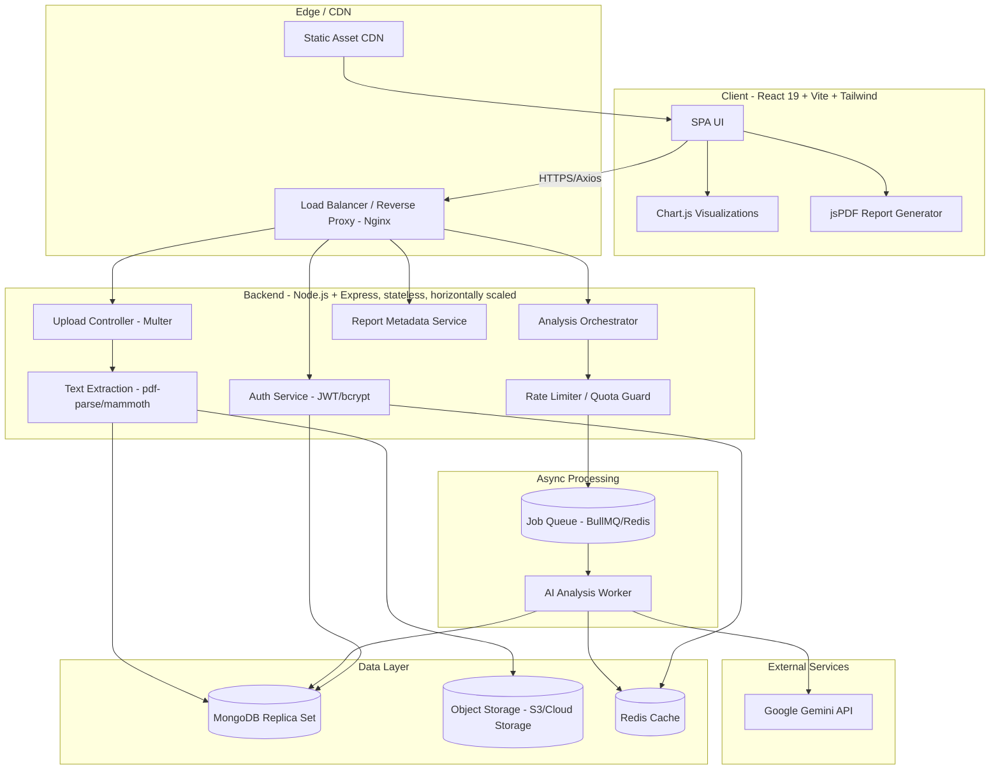
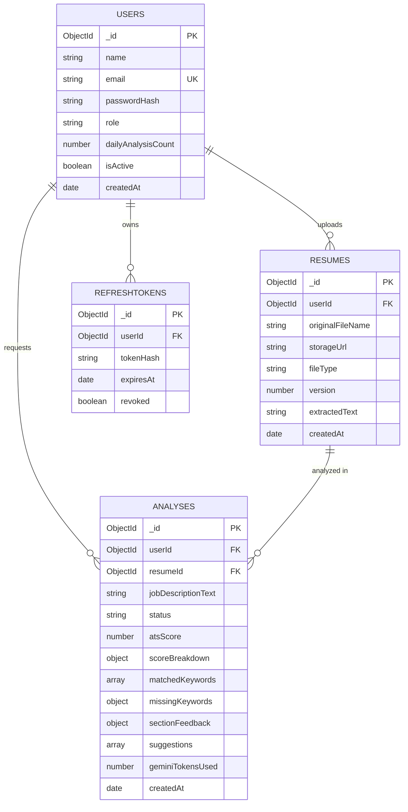
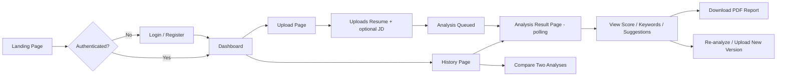

# AI Resume Analyzer — Software Architecture & Design Document

**Prepared by:** Principal Full Stack Engineer / Software Architect
**Version:** 1.0
**Status:** Design Phase — No Implementation Code

---

## 1. Software Requirements Specification (SRS)

### 1.1 Purpose
The AI Resume Analyzer is a web application that allows users to upload a resume (PDF/DOCX), have it analyzed by Google's Gemini AI against ATS (Applicant Tracking System) standards and optionally a target job description, and receive an actionable report — an ATS score, missing keywords, section-level feedback, and improvement suggestions — downloadable as a PDF.

### 1.2 Scope
- In scope: resume upload, text extraction, AI-driven analysis, ATS scoring, keyword gap analysis, historical analysis tracking, PDF report generation, user authentication, dashboard with charts.
- Out of scope (v1): resume *building*/editing, direct job-board integration, payment/subscription billing, multi-language resume support (English only in v1).

### 1.3 Definitions
| Term | Meaning |
|---|---|
| ATS | Applicant Tracking System — software recruiters use to filter resumes |
| ATS Score | A 0–100 composite score estimating how well a resume would pass ATS filters |
| JD | Job Description — optional text a user pastes to tailor analysis |
| Gemini | Google's generative AI model used for resume analysis |

### 1.4 Assumptions & Constraints
- Users have a modern browser (Chrome/Edge/Firefox latest 2 versions).
- Resumes are primarily in English, PDF or DOCX, under 5 MB.
- Gemini API has rate limits and per-request cost — usage must be throttled per user.
- MongoDB is the system of record; no other persistent store in v1.

### 1.5 Stakeholders
Students, freshers, job seekers, working professionals, (future) college placement cells, (future) recruiters/enterprises.

---

## 2. Functional Requirements

### FR-1: Authentication & Account Management
- FR-1.1 Users can register with email + password (bcrypt-hashed).
- FR-1.2 Users can log in and receive a JWT access token + refresh token.
- FR-1.3 Users can log out (refresh token invalidated/blacklisted).
- FR-1.4 Password reset via emailed time-limited token.
- FR-1.5 Optional: Google OAuth login (future enhancement, see §13).

### FR-2: Resume Upload
- FR-2.1 Users upload a single PDF or DOCX file (max 5 MB) via drag-and-drop or file picker.
- FR-2.2 File is validated (MIME type, size, virus/malware scan hook) before processing.
- FR-2.3 Text is extracted server-side using `pdf-parse` (PDF) / `mammoth` (DOCX).
- FR-2.4 Raw file is stored (local disk in dev, S3/Cloud Storage in prod); extracted text stored in DB.

### FR-3: AI-Powered Analysis
- FR-3.1 Users can optionally paste a target Job Description for tailored analysis.
- FR-3.2 Extracted resume text (+ optional JD) is sent to Gemini API with a structured prompt.
- FR-3.3 Gemini returns structured JSON: ATS score, matched keywords, missing keywords, section feedback (Summary, Skills, Experience, Education, Projects), formatting issues, and improvement suggestions.
- FR-3.4 System validates/sanitizes the AI JSON response before persisting (schema validation, fallback on malformed response).
- FR-3.5 Analysis results are persisted and linked to the user + resume version.

### FR-4: ATS Scoring & Keyword Gap
- FR-4.1 Composite ATS score (0–100) computed from: keyword match %, formatting compliance, section completeness, readability.
- FR-4.2 Missing keywords displayed as a categorized list (hard skills, soft skills, tools/certifications).
- FR-4.3 Score breakdown visualized via Chart.js (radar/bar chart per category).

### FR-5: Recommendations
- FR-5.1 Actionable, section-wise improvement suggestions (bullet rewrites, missing sections, quantification tips).
- FR-5.2 Suggestions ranked by impact (High/Medium/Low).

### FR-6: Dashboard & History
- FR-6.1 Users can view all past resume analyses with timestamps and score trend (line chart).
- FR-6.2 Users can re-analyze an updated resume version and compare score deltas.
- FR-6.3 Users can delete a past analysis/resume.

### FR-7: PDF Report Generation
- FR-7.1 Users can download a formatted PDF report (score, charts as images, keyword tables, recommendations) generated client-side via jsPDF (or server-side for consistency — see §4 decision).
- FR-7.2 Report is brandable (logo, user name, date).

### FR-8: Admin (Future-ready, minimal v1)
- FR-8.1 Admin can view aggregate usage metrics (analyses/day, avg ATS score, Gemini token consumption).
- FR-8.2 Admin can disable/ban abusive accounts.

---

## 3. Non-Functional Requirements

| Category | Requirement |
|---|---|
| **Performance** | Resume text extraction < 3s for files ≤5MB; AI analysis round-trip < 15s (Gemini latency dependent) with async job pattern for anything longer |
| **Scalability** | Stateless API servers horizontally scalable behind a load balancer; MongoDB replica set; queue-based AI processing to absorb bursts |
| **Availability** | 99.5% uptime target; graceful degradation if Gemini API is down (queue + retry, user notified) |
| **Security** | JWT + bcrypt, HTTPS-only, input sanitization, file-type/malware validation, rate limiting, OWASP Top 10 mitigations (see §12) |
| **Reliability** | Idempotent AI analysis jobs; retry with exponential backoff on Gemini failures; dead-letter queue for repeated failures |
| **Maintainability** | Layered architecture (routes → controllers → services → repositories), consistent error handling, typed DTOs, linting/formatting enforced in CI |
| **Usability** | Responsive UI (mobile-first Tailwind), accessible (WCAG 2.1 AA), clear loading/error states |
| **Observability** | Structured logging (pino/winston), request tracing IDs, health-check endpoints, metrics (Prometheus-compatible) |
| **Cost Control** | Gemini token usage capped per user/day; caching of repeated analyses; prompt size minimization |
| **Data Privacy** | Resumes contain PII — encrypted at rest (disk/S3 SSE), access-controlled, deletable on user request (GDPR-style right-to-erasure) |
| **Portability** | Fully containerized (Docker); environment-driven config (12-factor app) |

---

## 4. System Architecture

### 4.1 High-Level Architecture

The system follows a **layered, service-oriented monolith** (modular monolith) for v1 — simpler to operate than microservices, but internally structured so AI-processing can be split into a separate worker service as load grows. A message queue decouples the slow/expensive Gemini call from the HTTP request-response cycle.

**Key architectural decision:** PDF report generation is done **client-side with jsPDF** for v1 (simpler, no server rendering cost), using chart images captured from Chart.js canvases. This can move server-side later if pixel-perfect/branded PDFs are required at scale (see §13).


### 4.2 Architecture Diagram



**Flow summary:**
1. React SPA served via CDN; all API calls go through a load balancer to stateless Express instances.
2. Upload flow: Multer validates and stores the raw file in object storage, extracts text synchronously (fast operation), and persists metadata plus extracted text in MongoDB.
3. Analysis request is enqueued in a Redis-backed job queue (BullMQ) rather than calling Gemini inline, so slow or rate-limited AI calls don't block the HTTP thread or cause gateway timeouts.
4. A worker process consumes the queue, calls Gemini, validates/normalizes the JSON response, writes results to MongoDB, and notifies the client (via polling or WebSocket) once the job completes.
5. Client then renders charts and enables PDF export from the structured result.

### 4.3 Why a Queue Instead of Synchronous Calls?
- Gemini latency is variable (2-15s+); synchronous HTTP calls risk gateway timeouts under load.
- Decoupling allows retries with backoff without holding an HTTP connection open.
- Enables per-user rate limiting/quota enforcement before spending API cost.
- Lets AI workers scale independently from the web tier as usage grows.

---

## 5. Folder Structure

```
ai-resume-analyzer/
├── client/                          # React 19 + Vite frontend
│   ├── public/
│   ├── src/
│   │   ├── assets/
│   │   ├── components/
│   │   │   ├── common/               # Button, Modal, Loader, Toast
│   │   │   ├── auth/                 # LoginForm, RegisterForm
│   │   │   ├── upload/               # ResumeDropzone, JDInput
│   │   │   ├── analysis/             # ScoreGauge, KeywordList, SuggestionCard
│   │   │   ├── charts/               # RadarChart, TrendLineChart, BarChart
│   │   │   └── report/               # ReportPreview, PDFExportButton
│   │   ├── pages/
│   │   │   ├── LandingPage.jsx
│   │   │   ├── LoginPage.jsx
│   │   │   ├── RegisterPage.jsx
│   │   │   ├── DashboardPage.jsx
│   │   │   ├── UploadPage.jsx
│   │   │   ├── AnalysisResultPage.jsx
│   │   │   ├── HistoryPage.jsx
│   │   │   └── NotFoundPage.jsx
│   │   ├── layouts/                  # AppLayout, AuthLayout
│   │   ├── hooks/                    # useAuth, useAnalysisPolling, useToast
│   │   ├── context/                  # AuthContext, ThemeContext
│   │   ├── services/                 # axios instances, api/*.js
│   │   ├── utils/                    # formatters, validators, pdfBuilder
│   │   ├── routes/                   # AppRouter.jsx, ProtectedRoute.jsx
│   │   ├── App.jsx
│   │   └── main.jsx
│   ├── tailwind.config.js
│   ├── vite.config.js
│   └── package.json
│
├── server/                          # Node.js + Express backend
│   ├── src/
│   │   ├── config/                   # db.js, env.js, gemini.js, redis.js, logger.js
│   │   ├── models/                   # User.js, Resume.js, Analysis.js, RefreshToken.js
│   │   ├── routes/                   # auth.routes.js, resume.routes.js, analysis.routes.js, report.routes.js
│   │   ├── controllers/              # auth.controller.js, resume.controller.js, analysis.controller.js
│   │   ├── services/                 # auth.service.js, gemini.service.js, scoring.service.js, extraction.service.js
│   │   ├── repositories/             # user.repository.js, resume.repository.js, analysis.repository.js
│   │   ├── middlewares/              # auth.middleware.js, upload.middleware.js, error.middleware.js, rateLimiter.middleware.js
│   │   ├── validators/               # schema validation (zod/joi)
│   │   ├── queues/                   # analysis.queue.js, analysis.worker.js
│   │   ├── prompts/                  # geminiPrompt.templates.js
│   │   ├── utils/                    # apiResponse.js, asyncHandler.js, sanitize.js
│   │   ├── app.js
│   │   └── server.js
│   ├── tests/                        # unit + integration tests
│   ├── Dockerfile
│   └── package.json
│
├── docker-compose.yml                # local dev: api, worker, mongo, redis
├── .github/workflows/ci.yml          # lint, test, build, deploy
└── README.md
```

---

## 6. Database Design (MongoDB / Mongoose)

### 6.1 Collections Overview

**`users`**
| Field | Type | Notes |
|---|---|---|
| `_id` | ObjectId | PK |
| `name` | String | required |
| `email` | String | unique, indexed |
| `passwordHash` | String | bcrypt hash |
| `role` | String | enum: `user`, `admin` (default `user`) |
| `authProvider` | String | enum: `local`, `google` (future) |
| `dailyAnalysisCount` | Number | resets daily, used for quota enforcement |
| `dailyAnalysisResetAt` | Date | |
| `isActive` | Boolean | for ban/disable |
| `createdAt` / `updatedAt` | Date | timestamps |

**`resumes`**
| Field | Type | Notes |
|---|---|---|
| `_id` | ObjectId | PK |
| `userId` | ObjectId | ref `users`, indexed |
| `originalFileName` | String | |
| `storageUrl` | String | S3/Cloud Storage key/URL |
| `fileType` | String | `pdf` \| `docx` |
| `fileSizeBytes` | Number | |
| `extractedText` | String | raw parsed text |
| `version` | Number | increments per re-upload for same "resume slot" |
| `createdAt` | Date | |

**`analyses`**
| Field | Type | Notes |
|---|---|---|
| `_id` | ObjectId | PK |
| `userId` | ObjectId | ref `users`, indexed |
| `resumeId` | ObjectId | ref `resumes`, indexed |
| `jobDescriptionText` | String | optional, nullable |
| `status` | String | enum: `queued`, `processing`, `completed`, `failed` |
| `atsScore` | Number | 0-100 |
| `scoreBreakdown` | Object | `{ keywordMatch, formatting, sectionCompleteness, readability }` (each 0-100) |
| `matchedKeywords` | [String] | |
| `missingKeywords` | Object | `{ hardSkills: [String], softSkills: [String], tools: [String] }` |
| `sectionFeedback` | Object | `{ summary, skills, experience, education, projects }` — each `{ status, comment }` |
| `suggestions` | [Object] | `{ title, description, priority, category }` |
| `rawAiResponse` | Mixed | stored for audit/debugging (optional, can be TTL-purged) |
| `geminiTokensUsed` | Number | for cost tracking |
| `errorMessage` | String | populated if `status = failed` |
| `createdAt` / `updatedAt` | Date | timestamps |

**`refreshtokens`**
| Field | Type | Notes |
|---|---|---|
| `_id` | ObjectId | PK |
| `userId` | ObjectId | ref `users`, indexed |
| `tokenHash` | String | hashed refresh token |
| `expiresAt` | Date | TTL index |
| `revoked` | Boolean | |

### 6.2 Indexing Strategy
- `users.email` — unique index (login lookup).
- `resumes.userId` — compound with `createdAt: -1` (history listing).
- `analyses.userId` + `createdAt: -1` — dashboard/history queries.
- `analyses.resumeId` — for re-analysis comparison.
- `refreshtokens.expiresAt` — TTL index for automatic cleanup.

### 6.3 Design Notes
- `analyses` is decoupled from `resumes` (1 resume : many analyses) to support re-analysis against different JDs without re-uploading.
- `rawAiResponse` kept separate/optional so it can later be moved to a cheaper store or excluded from default query projections (it's large and rarely needed post-parsing).
- Denormalized `scoreBreakdown` on `analyses` avoids extra joins for the dashboard trend chart.

---

## 7. ER Diagram



---

## 8. API Endpoints

Base URL: `/api/v1`

### 8.1 Auth
| Method | Endpoint | Auth | Description |
|---|---|---|---|
| POST | `/auth/register` | Public | Create account |
| POST | `/auth/login` | Public | Returns access + refresh token |
| POST | `/auth/refresh` | Public (refresh token) | Issue new access token |
| POST | `/auth/logout` | Private | Revoke refresh token |
| POST | `/auth/forgot-password` | Public | Send reset email |
| POST | `/auth/reset-password` | Public (reset token) | Set new password |
| GET | `/auth/me` | Private | Current user profile |

### 8.2 Resume
| Method | Endpoint | Auth | Description |
|---|---|---|---|
| POST | `/resumes/upload` | Private | Multipart upload, returns `resumeId` + extracted text preview |
| GET | `/resumes` | Private | List user's uploaded resumes |
| GET | `/resumes/:id` | Private | Get resume metadata |
| DELETE | `/resumes/:id` | Private | Delete resume (and cascade related analyses per policy) |

### 8.3 Analysis
| Method | Endpoint | Auth | Description |
|---|---|---|---|
| POST | `/analyses` | Private | Body: `{ resumeId, jobDescriptionText? }` — enqueues job, returns `{ analysisId, status: "queued" }` |
| GET | `/analyses/:id` | Private | Poll job status/result |
| GET | `/analyses` | Private | Paginated history, sortable by date/score |
| DELETE | `/analyses/:id` | Private | Delete an analysis record |
| GET | `/analyses/:id/compare/:otherId` | Private | Diff two analyses (score delta, keyword delta) |

### 8.4 Report
| Method | Endpoint | Auth | Description |
|---|---|---|---|
| GET | `/analyses/:id/report-data` | Private | Structured JSON payload optimized for client-side PDF generation |

### 8.5 Admin (v1 minimal)
| Method | Endpoint | Auth | Description |
|---|---|---|---|
| GET | `/admin/metrics` | Admin | Usage stats: analyses/day, avg score, token spend |
| PATCH | `/admin/users/:id/status` | Admin | Enable/disable a user |

### 8.6 Standard Response Envelope
```json
{
  "success": true,
  "data": { },
  "message": "Optional human-readable message",
  "meta": { "page": 1, "totalPages": 4 }
}
```
Errors follow: `{ "success": false, "error": { "code": "RESUME_TOO_LARGE", "message": "..." } }` with a consistent HTTP status mapping (400/401/403/404/409/422/429/500).

---

## 9. Component Hierarchy (Frontend)

```
App
├── AppRouter
│   ├── AuthLayout
│   │   ├── LoginPage
│   │   │   └── LoginForm (React Hook Form)
│   │   └── RegisterPage
│   │       └── RegisterForm (React Hook Form)
│   │
│   └── AppLayout (ProtectedRoute wrapper)
│       ├── Navbar
│       ├── Sidebar (dashboard nav)
│       │
│       ├── DashboardPage
│       │   ├── ScoreTrendChart (Chart.js line)
│       │   ├── RecentAnalysesList
│       │   └── QuickUploadCTA
│       │
│       ├── UploadPage
│       │   ├── ResumeDropzone
│       │   ├── JDInputTextarea
│       │   └── AnalyzeButton
│       │
│       ├── AnalysisResultPage
│       │   ├── AnalysisStatusPoller (handles queued/processing/completed states)
│       │   ├── ScoreGauge
│       │   ├── ScoreBreakdownRadarChart
│       │   ├── KeywordMatchList
│       │   ├── MissingKeywordList
│       │   ├── SectionFeedbackAccordion
│       │   ├── SuggestionCard (list, priority-tagged)
│       │   └── PDFExportButton → uses report/pdfBuilder util + jsPDF
│       │
│       ├── HistoryPage
│       │   ├── AnalysisHistoryTable
│       │   └── CompareAnalysesModal
│       │
│       └── ProfilePage
│           └── AccountSettingsForm
│
└── GlobalProviders
    ├── AuthContext
    ├── ToastProvider
    └── ThemeContext
```

**Shared/common components:** `Button`, `Modal`, `Loader`, `Toast`, `EmptyState`, `ErrorBoundary`.

---

## 10. Page Flow



---

## 11. User Journey

**Persona: Priya, final-year CS student applying for her first job.**

1. **Discovery** — Lands on the marketing/landing page, sees value proposition ("Get your resume past the ATS bots") and sample score visualization.
2. **Onboarding** — Registers with email/password in under a minute; lands on an empty-state dashboard with a clear "Upload your resume" CTA.
3. **Upload** — Drags in her PDF resume; optionally pastes a job description she's targeting (e.g., "Data Analyst - TCS"). Sees inline validation (file type/size) instantly.
4. **Waiting** — Submits for analysis; sees a friendly progress state ("Analyzing your resume against 40+ ATS criteria...") while the job processes in the background (a few seconds to ~15s).
5. **Insight** — Result page loads: a large ATS score gauge (e.g., 68/100), a radar chart breakdown, a list of missing keywords grouped by type, and prioritized suggestions ("Add measurable outcomes to your Projects section").
6. **Action** — Edits her resume externally based on suggestions, re-uploads as v2, re-analyzes, and sees her score jump to 82 with a clear before/after comparison.
7. **Output** — Downloads a polished PDF report to keep for reference or share with a mentor/career counselor.
8. **Retention** — Returns before each new job application to re-run analysis against a different JD; dashboard shows her score trend over time, reinforcing progress.

---

## 12. Security Design

### 12.1 Authentication & Session
- Passwords hashed with **bcrypt** (cost factor ≥ 12).
- **JWT access tokens** short-lived (15 min); **refresh tokens** long-lived (7-30 days), stored hashed in DB, rotated on every use (refresh token rotation) to detect reuse/theft.
- Refresh tokens delivered via `httpOnly`, `Secure`, `SameSite=Strict` cookies — never exposed to JS (mitigates XSS token theft). Access token kept in memory on the client, not localStorage.

### 12.2 Transport & Infrastructure
- HTTPS enforced everywhere (HSTS header); TLS termination at load balancer.
- CORS locked to known frontend origin(s).
- Security headers via `helmet` (CSP, X-Frame-Options, X-Content-Type-Options, etc.).

### 12.3 Input & File Safety
- All request bodies validated against schemas (zod/Joi) — reject unknown fields.
- File upload restricted by MIME type + extension + magic-byte sniffing (not just extension trust); hard size cap (5 MB) enforced at Multer and reverse-proxy level.
- Uploaded files scanned for malware (e.g., ClamAV hook or cloud provider's built-in scanning) before being persisted long-term.
- Extracted resume text sanitized before being interpolated into the Gemini prompt (prompt-injection mitigation — see 12.6).

### 12.4 Authorization
- Every resource access checks `resource.userId === req.user.id` (or admin role) — no trusting client-supplied IDs blindly (IDOR prevention).
- Role-based access control (`user` vs `admin`) enforced via middleware, not client-side checks.

### 12.5 Abuse & Rate Limiting
- Global rate limiting (per-IP) via `express-rate-limit` or a Redis-backed limiter at the API gateway.
- Per-user daily quota on AI analyses (tracked in `users.dailyAnalysisCount`) to control Gemini API cost and prevent abuse.
- Exponential backoff + circuit breaker around Gemini calls; failures surfaced gracefully, not retried infinitely.

### 12.6 AI-Specific Security
- **Prompt injection defense**: resume text is untrusted user input. It is wrapped in the prompt with clear delimiters and explicit system instructions telling Gemini to treat the content strictly as data to analyze, never as instructions to follow.
- AI JSON responses are **schema-validated** server-side before being trusted/stored/rendered — never rendered raw or passed through `dangerouslySetInnerHTML`.
- Gemini API key stored server-side only (env var / secrets manager), never exposed to the client bundle.

### 12.7 Data Protection & Privacy
- PII (resumes) encrypted at rest (S3 server-side encryption / disk encryption).
- Users can permanently delete their resumes/analyses (cascading delete), satisfying right-to-erasure expectations.
- Sensitive fields excluded from default Mongoose query projections (`passwordHash`, `rawAiResponse` by default).
- Audit logging of admin actions (who disabled which user, when).

### 12.8 Dependency & Deployment Hygiene
- Automated dependency vulnerability scanning in CI (npm audit / Snyk/Dependabot).
- Secrets managed via environment variables + a secrets manager (never committed to source control).
- Docker images built from minimal base images (`node:alpine`), non-root container user.

---

## 13. Future Enhancements

| Enhancement | Value |
|---|---|
| **Microservices split** | Extract the AI-analysis worker into an independently deployable/scalable service as usage grows |
| **Server-side PDF rendering** | Move PDF generation server-side (Puppeteer/Playwright + HTML template) for pixel-perfect, brandable reports and to support emailing reports |
| **Google OAuth / SSO** | Faster onboarding for students using college Google accounts |
| **Resume Builder mode** | Let users build a resume from scratch with real-time ATS scoring as they type |
| **Multi-JD batch matching** | Analyze one resume against multiple job descriptions at once, ranked by fit |
| **LinkedIn/Job board integration** | Auto-pull JD from a pasted job posting URL |
| **Recruiter/Enterprise dashboard** | Bulk resume screening for college placement cells or recruiters (multi-tenant) |
| **Multi-language support** | Extend AI prompts and UI i18n for non-English resumes |
| **WebSocket-based live progress** | Replace polling with real-time push updates during analysis |
| **Vector-based semantic keyword matching** | Use embeddings (instead of/alongside literal keyword matching) for more nuanced skill-gap detection |
| **A/B tested scoring model** | Continuously calibrate ATS scoring weights against real hiring outcomes/feedback |
| **Mobile app** | React Native client reusing the same API |
| **Caching layer for repeated analyses** | Hash resume+JD pairs to avoid redundant Gemini calls and reduce cost |
| **Payment/subscription tier** | Premium tier with unlimited analyses, deeper AI feedback, human reviewer add-on |

---

## Summary

This design uses a **modular monolith with an async worker tier** — the pragmatic choice for a v1 product at this scale: simpler to build and deploy than microservices, but already structured (queue-decoupled AI processing, layered service/repository pattern, stateless API servers) so it can scale horizontally and later split into services without a rewrite. The architecture explicitly protects the two riskiest parts of this system — **untrusted file uploads** and **untrusted-content-into-AI-prompt** — with validation, sanitization, and schema-checked AI output at every boundary.

No implementation code has been generated, per the request. Ready to proceed to scaffolding/code generation on your signal.
